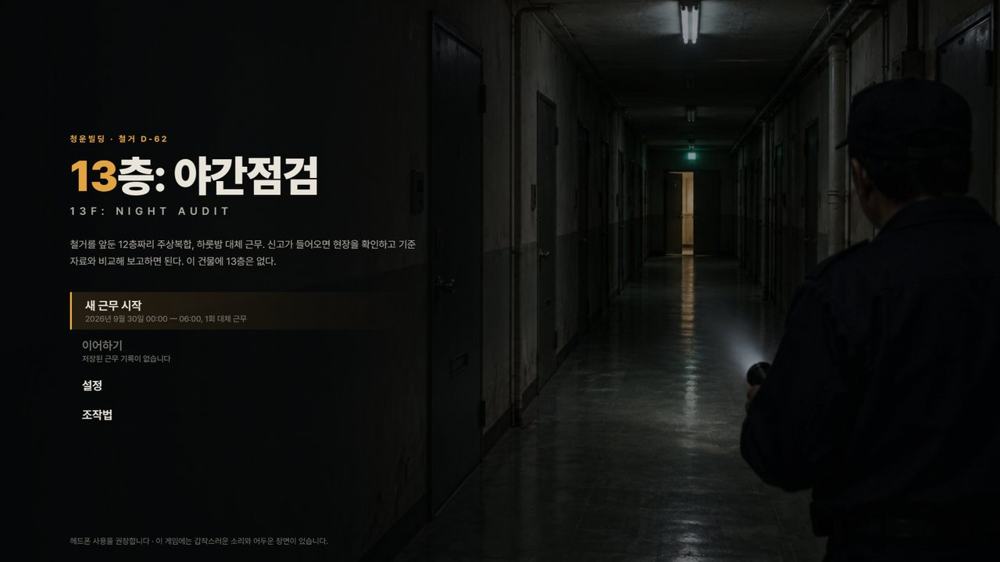
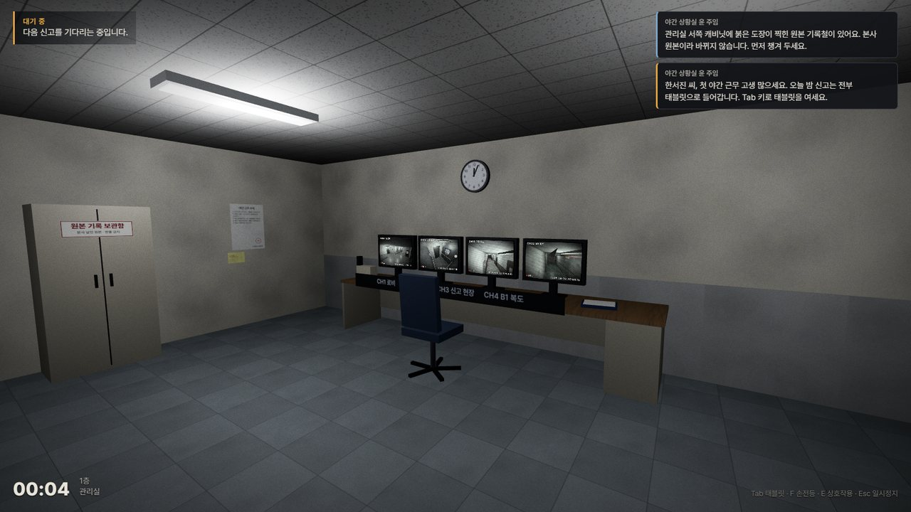
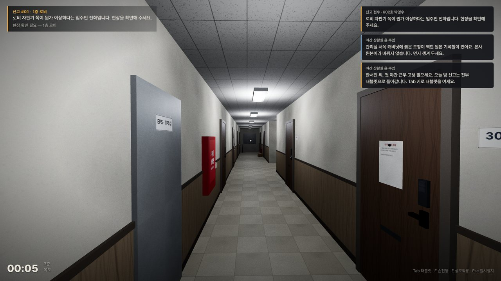
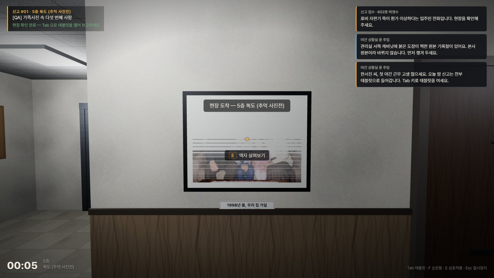
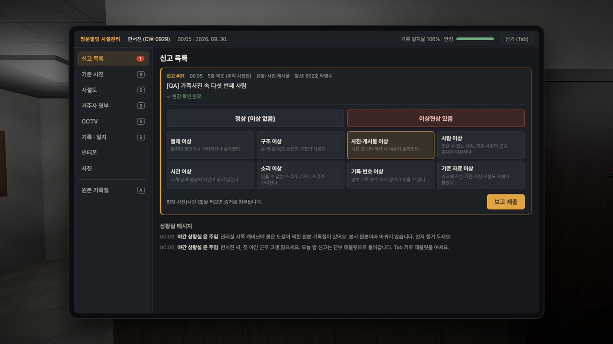
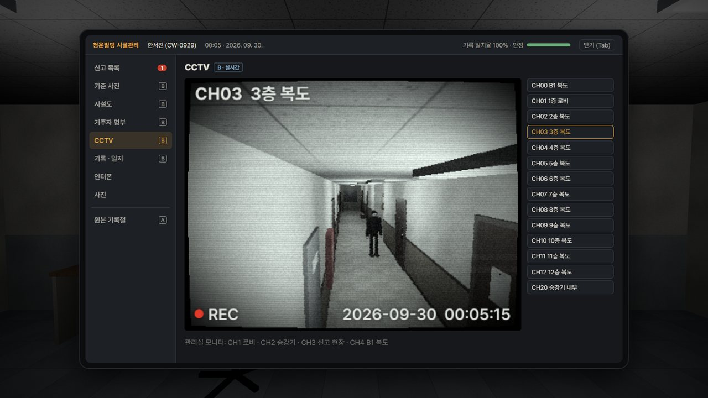
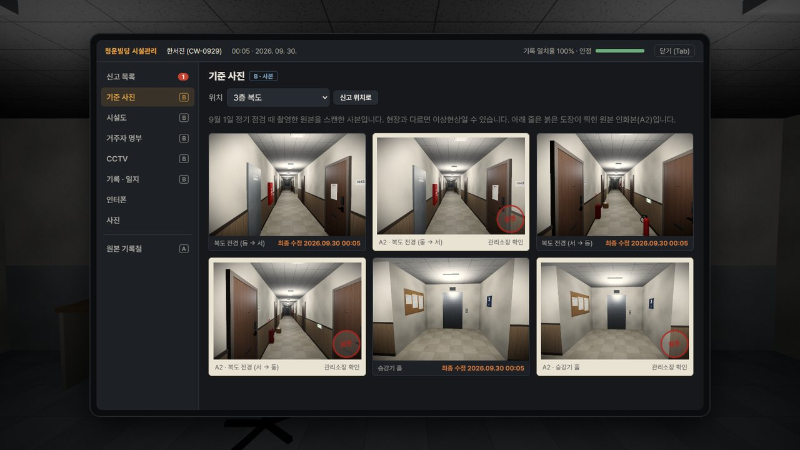
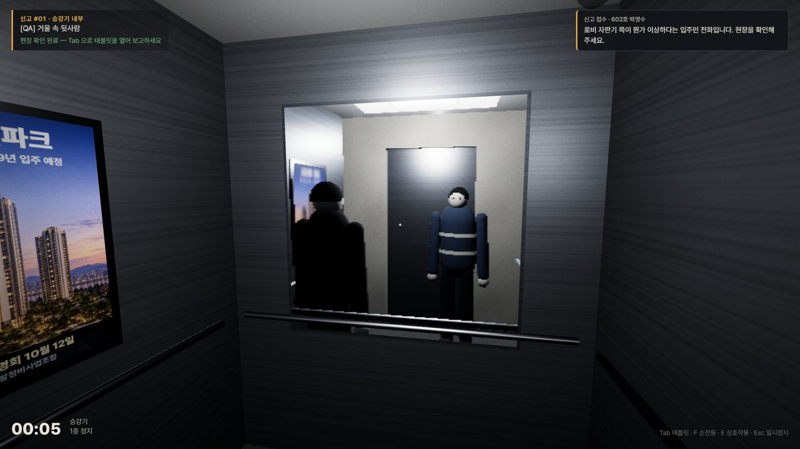
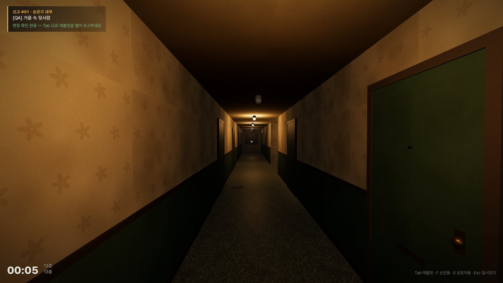
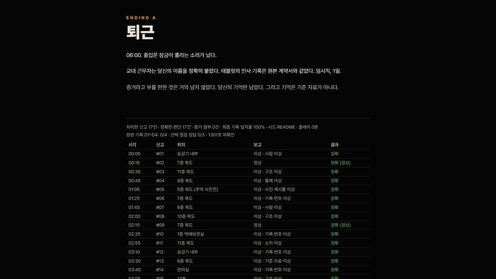

# 13층: 야간점검 (13F: Night Audit)

재개발을 앞둔 1994년 준공 12층 주상복합 **청운빌딩**. 당신은 00:00–06:00 대체 야간 관리 근무자 한서진입니다.
민원이 들어오면 현장을 확인하고, 기준 자료와 비교하고, 이상 여부를 판정해 보고합니다.
처음에는 물건과 입주민이 이상해지고, 나중에는 CCTV, 명부, 기준 사진, 승강기 기록, 그리고 당신의 인사 기록까지 흔들립니다.

> "원래 이랬던가?"

1인칭 이상현상 관찰 심리 호러 · 데스크톱 웹 브라우저 · 한국어 · 첫 클리어 약 30–45분 · 엔딩 3종



## 빠른 시작 (Windows)

`start.bat`을 더블클릭하세요. 처음 실행하면 의존성 설치와 빌드를 한 뒤 브라우저에서 게임(http://localhost:4173)이 열립니다. Node.js 22 LTS 이상이 필요합니다 (Vite 8 요구 사항).

| 명령 | 동작 |
| --- | --- |
| `start.bat` | 필요하면 빌드한 뒤 프로덕션 빌드 실행 |
| `start.bat rebuild` | 새로 빌드한 뒤 실행 |
| `start.bat dev` | 개발 서버 실행 (http://localhost:5173, F9 디버그 패널) |

## 스크린샷

| | |
| --- | --- |
|  관리실 — CCTV 모니터와 근무 일지 |  주거층 복도 — 기준 상태는 일부러 지루하게 |
|  5층 추억 사진전 — 가족사진에 한 명이 늘었다 |  관리 태블릿 — 판정과 분류 보고 |
|  CCTV — 화면에만 보이는 사람 |  기준 사진(B 사본)과 원본 인화본(A) 대조 |
|  승강기 거울 속에만 있는 사람 |  존재하지 않는 13층 |



*스크린샷은 개발 서버에서 `node tests/e2e/readme-shots.mjs`로 촬영한 실제 게임 화면입니다 (1280×720으로 축소).*

## 핵심 플레이 방식

관리실 → 신고 접수(태블릿) → 기준 정보 확인 → 승강기/계단으로 이동 → 현장 확인 → CCTV·인터폰·기록·사진으로 대조 → **정상 / 이상현상 있음 + 분류** 보고 → 결과 → 다음 신고

- 신고 17건(1–4막)과 선택 점검 3건. 이야기용 신고는 고정, 나머지는 시드에 따라 검증된 이상현상 풀에서 선택됩니다.
- 정보의 신뢰 등급이 정해져 있습니다.
  - **A · 원본** — 관리실 보관함의 붉은 도장 원본 기록철. 바뀌지 않습니다.
  - **B · 사본/실시간** — CCTV, 거주자 명부, 승강기 기록, 기준 사진. 오염되면 틀어집니다.
  - **C · 사람의 말** — 신고 내용과 인터폰. 틀리거나 속일 수 있습니다.
  - **D · 기억** — 보장되지 않습니다.
- 틀린 보고(오신고·놓침·분류 오류)는 **기록 오염도**를 올립니다. 오염도가 오르면 소리 → CCTV → 명부 → 기준 사진 → 본인 기록 순서로 B 등급 정보가 불안정해집니다. 원본(A)은 끝까지 믿을 수 있습니다.
- 엔딩은 마지막 버튼이 아니라 근무 내용으로 결정됩니다: **퇴근**(정상), **상주 관리인**(오염도 70 이상 또는 본인 기록 이상 누락), **1301호**(숨은 문서 4건 + 선택 점검 2건 이상 정답 + 1301호 확인).

## 조작법

| 키 | 동작 |
| --- | --- |
| W A S D | 이동 (Shift: 빠르게 걷기) |
| 마우스 | 시점 (화면 클릭 시 마우스 고정) |
| E | 상호작용 / 닫기 |
| Tab | 관리 태블릿 열기·닫기 |
| F | 손전등 |
| Esc | 일시정지 · 메뉴 · 뒤로 |
| 마우스 클릭 | 태블릿·메뉴 조작 |

조작은 타이틀과 일시정지 메뉴의 '조작법'에서도 볼 수 있고, 첫 근무 중 상황실 메시지가 태블릿(Tab) 사용을 안내합니다. 설정: 마우스 감도, 상하 반전, 시야각, 화면 흔들림(헤드밥), 움직임 줄이기, 음량, 자막 크기, 밝기.

## 개발 환경

- TypeScript 7.0.2 · Three.js 0.186.1 · Vite 8.3.1 · Vitest 5.0.2 · playwright-core 1.63.0 (설치된 Chrome 사용)
- Node.js 24 / npm 11, Windows 11 + PowerShell에서 개발·검증
- 이미지 QA 도구: Python 3.13 + Pillow, OpenCV, NumPy
- 폰트: Pretendard Variable (`public/assets/fonts`, SIL OFL) — 오프라인에서도 로컬 폰트 사용
- 오디오: 파일 없이 WebAudio로 전부 합성

## 실행 방법

Windows에서는 `start.bat`만 실행하면 됩니다. 직접 실행하려면:

```powershell
npm install
npm run dev        # http://localhost:5173
```

## 빌드 방법

```powershell
npm run build      # tsc --noEmit + vite build → dist/
npm run preview    # http://localhost:4173 (빌드 결과 확인)
```

`dist/`는 상대 경로(`base: './'`)로 빌드되며 외부 네트워크 요청이 없습니다. 정적 파일 서버로 제공하면 오프라인에서 동작합니다.

## 프로젝트 구조

```
src/
  core/        RNG(시드), 입력, 설정, 이벤트
  data/        건물 기준 상태, 이상현상 레지스트리, 신고 슬롯·대사, 원본 기록, 위치, 이미지 레지스트리
  world/       모듈식 건물 키트(복도·계단·승강기·로비·B1·상가·1204호·13층), 절차 텍스처, 조명
  player/      1인칭 이동·충돌
  game/        Game(루프·모드), Director(시계·신고·보고·엔딩), 승강기, 런타임 이상현상
  systems/     규칙(오염도·신뢰 등급·판정·엔딩), 스케줄러, 저장, CCTV, 기준 사진, 오디오
  ui/          HUD, 태블릿, 메뉴·엔딩, 시설도
  debug/       개발 전용 도구 (프로덕션 번들에서 제외)
public/assets/ 승인된 이미지와 폰트만
art/           프롬프트, 원본 생성 후보(raw), QA 결과, 내보내기 목록 — 런타임에 포함되지 않음
tools/         이미지 생성 헬퍼, 이미지 쌍 QA, 내보내기, 문서 생성
tests/unit     Vitest
tests/e2e      Playwright 브라우저 테스트
docs/          anomaly-manifest.json, image-assets.json, image-prompts.md, validation.md
```

## 이상현상 시스템

- `src/data/anomalies.ts`에 **50개**의 이상현상이 데이터로 정의되어 있습니다 (물체 9, 구조 8, 사진·게시물 5, 사람 5, 시간 4, 소리 5, 기록·번호 11, 기준 자료 3 · 난이도 1–5).
- 각 항목: 기준 상태, 이상 상태, 의도된 차이 1개, 금지된 차이, 탐지 경로(채널), 초기화 규칙, 분류, 난이도, 오염 영향, 목적.
- 구현 방식은 세 가지입니다: 층 빌더가 적용하는 **물리 변경**(문 추가, 복도 연장, 천장 낮아짐 등), **데이터 변경**(명부·로그·기준 사진), **런타임 동작**(다가가면 사라지는 사람, 쾅 닫히는 문, 따라오는 발소리, 호출 없이 오는 승강기, 계단 루프, 거울 속 사람).
- 월드는 저장된 논리 상태(시드 + 진행)로부터 매번 결정적으로 다시 만들어집니다. 조명 깜빡임도 시드 없는 난수 없이 결정적입니다.
- CCTV는 실제 보조 카메라 + 렌더 타깃 + 열화 셰이더 + 코드로 그린 타임스탬프 + 지연 포즈 버퍼로 동작합니다.
- 스케줄러는 `${seed}|${slot}|band`로 시드를 나눠 같은 시드에서 항상 같은 근무를 만들고, 막·난이도 범위와 중복 금지를 지킵니다.
- 전체 목록: `docs/anomaly-manifest.json` (`npm run docs:manifest`로 코드에서 재생성).

## 이미지 생성 에셋 파이프라인

1. 프롬프트 파일(`art/prompts/*.txt`) → `tools/imagegen/codex-image.ps1` → Codex CLI 내장 `image_gen` → `art/raw/<id>/normal_v1.png`
2. 정상 원본(master)을 검토·승인
3. 이상 버전은 **승인된 원본을 참조 이미지로 넣은 편집**으로만 생성 (`-RefImage`), 의도된 차이 1개만 요청
4. `tools/imageqa/pair_qa.py`: 정렬(ECC, 비정상 변환은 거부) → SSIM + LabΔE 변화 마스크 → ROI 안/밖 변화율 → 필요 시 ROI 밖은 원본 픽셀로 합성 → 리뷰 시트 생성
5. 자동 지표 + 사람이 직접 리뷰 시트를 보고 승인. 거절된 시도는 `art/pairs.json`에 기록
6. `tools/imageqa/export_assets.py`가 승인된 것만 `public/assets/images/`로 내보내고 `docs/image-assets.json`을 씀

게임 안의 모든 한국어 글자(간판, 게시물, 전단, 기록, UI)는 코드로 그립니다. 생성 이미지에는 게임 진행에 필요한 글자가 없습니다. 사람 형체의 3D 모델은 얼굴 없는 단순 형태라 AI 얼굴 드리프트가 생길 수 없습니다.

## 검증 방식

```powershell
npm run typecheck
npm test                 # 단위 테스트 30개 (레지스트리·에셋·스케줄러·규칙·전체 근무 시뮬레이션·저장)
npm run dev              # 다른 터미널에서
npm run build; npm run preview   # 또 다른 터미널에서
npm run e2e              # UI 레이아웃 감사 · 기능 검사 · 엔딩 3종 플레이스루 · 프로덕션 스모크
npm run e2e:gallery      # 이상현상별 스크린샷 (tests/e2e/out/gallery)
npm run qa:images        # 이미지 쌍 QA
npm run qa:zfight        # Z-fighting 검사: 모든 층 × 모든 이상현상 상태에서 겹치는 동일 평면 삼각형 탐지
```

### Z-fighting 방지 규칙

- 벽 장식(징두리판 12 mm, 걸레받이 20 mm, 몰딩 25 mm)은 벽면보다 앞으로 나오게 배치하고, 각기 다른 깊이를 씁니다.
- 벽끼리 만나는 곳에서는 한쪽 벽이 다른 벽의 표면을 뚫고 나오지 않게 합니다. 예: 방 옆벽은 복도 벽 뒷면에서 끝나고, 계단실 서쪽 벽이 복도 동쪽 끝을 대신합니다.
- 문틀·승강기 틀은 개구부 단면보다 5 mm 안쪽에 두고, 겹치는 승강기 문짝은 4 mm 앞뒤로 어긋나게 둡니다.
- 정적 배치 박스는 월드 좌표 기반 UV를 씁니다. 같은 재질의 면이 같은 평면에서 겹쳐도 같은 텍셀이 나와 깜빡임이 보이지 않습니다.
- 카메라 near 값은 0.1(플레이어 충돌 반경 0.28보다 작음)로 설정해 깊이 정밀도를 0.05 대비 두 배로 높였습니다.

실제 실행 결과와 날짜, 버전, 실패와 수정 내역은 `docs/validation.md`에 있습니다. 최초 제작 요청과 달라진 점은 `docs/changes-from-original-request.md`에 정리되어 있습니다.

개발 서버에서는 F9로 디버그 패널(이상현상 강제, 층 이동, 오염도 설정, 시드·활성 이상현상 확인, 스크린샷)을 열 수 있습니다. 프로덕션 빌드에는 포함되지 않습니다.

## 알려진 제한사항

- 자동 플레이스루는 이동 시간을 줄이려고 신고 현장으로 순간이동하고, 신고 사이 대기 시간을 건너뜁니다. 현장 도착 판정·상호작용·보고 입력은 실제 코드 경로입니다. 사람이 처음부터 끝까지 직접 플레이한 시간(30–45분 목표)은 측정하지 않았습니다.
- 헤드리스 Chrome에서만 자동 검증했습니다. 소리는 코드 경로(발소리 발생·음소거·스팅어 횟수)로 확인했고 실제 청취 품질은 확인하지 않았습니다.
- 포인터 잠금은 헤드리스 환경에서 동작하지 않아 마우스 시점 조작은 자동 테스트하지 않았습니다.
- 이미지 생성에 쓰인 Codex 내장 `image_gen`의 실제 이미지 모델 이름은 로그에 드러나지 않아 확인하지 못했습니다.
- JS 번들은 약 790 KB(gzip 224 KB)의 단일 청크입니다.
